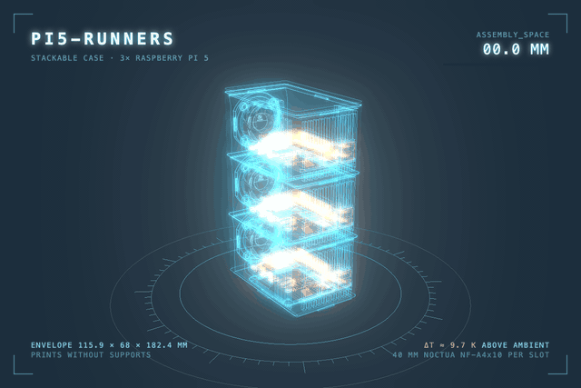
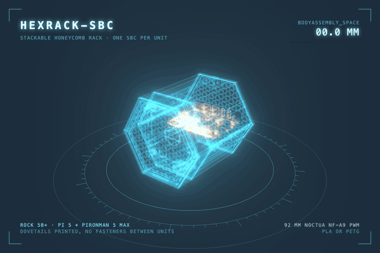

## David Lepaux

**AI Engineer and Engineering Lead** in Lausanne, Switzerland. I build LLM agents that act safely on real systems: MCP servers, per-person auth, confirmation before any write. Before that, 13 years of web platforms for luxury, sports, e-commerce and media.

Started writing code professionally in 2013. Still hands-on by choice, every day. Web in React, Next.js and TypeScript. Services and systems in Rust (lower-level primitives, the parts you only see when the runtime stops helping).

**Worked with** FIBA · Visilab · Patek Philippe · Lausanne Tourisme · Publishing Factory

---

### Household AI assistant

A chat assistant that acts as each person in a household (their own token, every action filed in their name) and asks before anything changes. Few deliberate tools, each person's language, failures counted and alerting. Media is the test bed. The pattern is the point.

[**kavita-mcp**](https://github.com/dlepaux/kavita-mcp) — MCP server in Rust. Search your Kavita libraries and send a book to your Kindle, as yourself, after a confirmation.

[**seerr-mcp**](https://github.com/dlepaux/seerr-mcp) — MCP server in Rust. Search and request films and series in Seerr, as yourself, after a confirmation.

---

### Open Source

[**realtime-bpm-analyzer**](https://github.com/dlepaux/realtime-bpm-analyzer) — Zero-dependency TypeScript library for real-time BPM detection via the Web Audio API. Used in music players, DJ tools, and streaming services.

 

[**docker-exporter**](https://github.com/dlepaux/docker-exporter) — Lightweight Rust Prometheus exporter for Docker container metrics. Built for ARM64 + cgroup v2, multi-arch image on GHCR.

<!-- downloads: GHCR exposes no public pull-count API. Currently sourced from ghcr-badge.elias.eu.org (live HTML-scrape of the package page's "Total downloads"; a layer-download tally, not unique pulls). backage (ipitio/backage) is starred and will serve sturdier static JSON at https://ipitio.github.io/backage/dlepaux/docker-exporter.json (query $.downloads) once its crawler indexes — swap the url below to it then. -->
 

---

### 3D printing

Parametric cases in OpenSCAD, printed and tested. Each loop is rendered from the CAD itself, pulled apart by its own assembly parameter.

<table>
<tr>
<td width="50%"></td>
<td width="50%"></td>
</tr>
<tr>
<td valign="top"><a href="https://dlepaux.github.io/pi5-runners/"><b>pi5-runners</b></a> A stack for three Raspberry Pi 5s running as GitHub Actions runners. One 40 mm Noctua per module, nothing screwed together but the fans, every part prints without supports.</td>
<td valign="top"><a href="https://github.com/dlepaux/hexrack-sbc"><b>hexrack-sbc</b></a> A modular honeycomb rack, one SBC per unit behind a 92 mm Noctua. The configurator engraves labels with real OpenSCAD compiled to WebAssembly.</td>
</tr>
</table>

---

### Stack

**Day to day**

      

**Infra and AI**

 

**By volume** (public + private repos)

---

 
